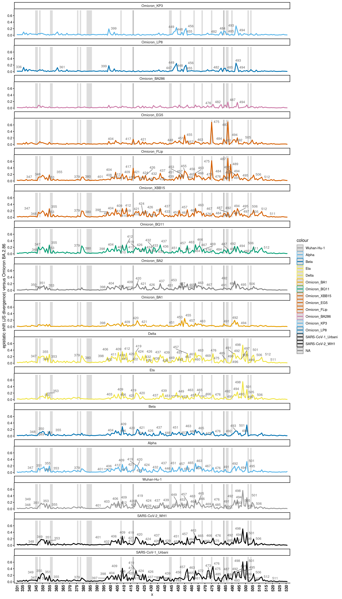
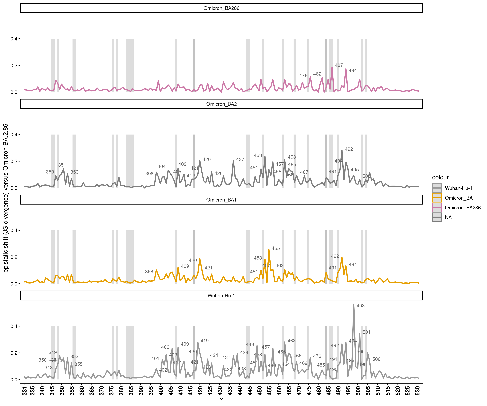
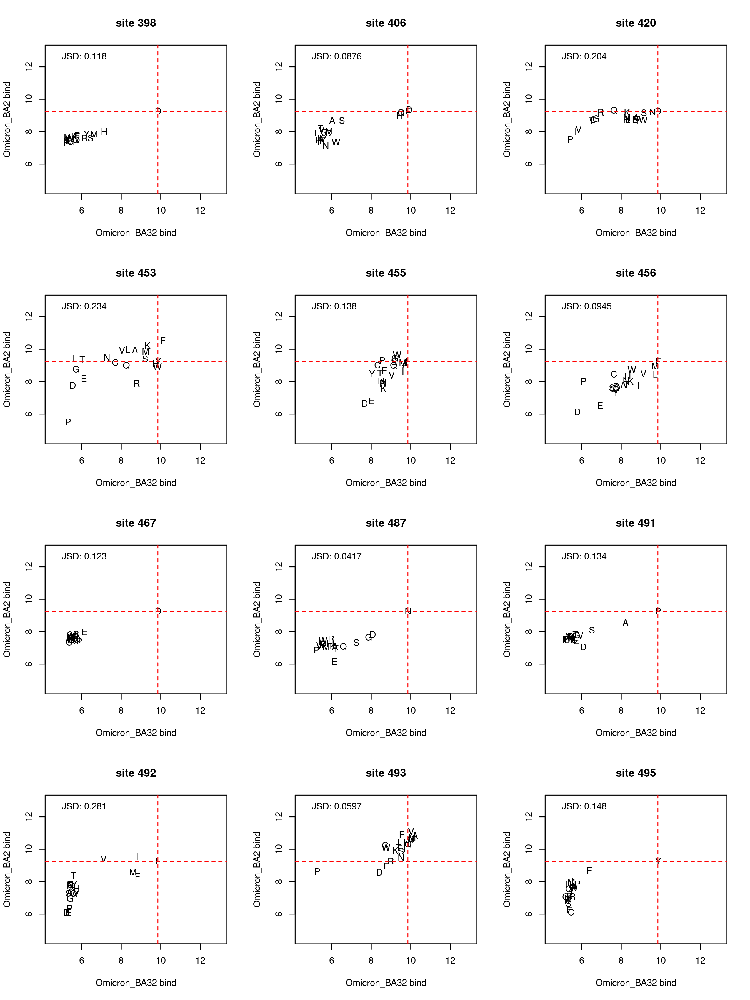

Shifts in mutation effects among variant backgrounds
================
Tyler Starr
6/13/2024

- <a href="#setup" id="toc-setup">Setup</a>
- <a
  href="#calculate-site-wise-jensen-shannon-divergence-a-metric-of-divergence-in-site-specific-mutational-profiles"
  id="toc-calculate-site-wise-jensen-shannon-divergence-a-metric-of-divergence-in-site-specific-mutational-profiles">Calculate
  site-wise Jensen-Shannon divergence, a metric of divergence in
  site-specific mutational profiles</a>
- <a href="#line-plots-of-js-divergence-from-wh1-across-rbd-sites"
  id="toc-line-plots-of-js-divergence-from-wh1-across-rbd-sites">Line
  plots of JS divergence from WH1 across RBD sites</a>
- <a href="#map-divergence-to-pdb-structure"
  id="toc-map-divergence-to-pdb-structure">Map divergence to pdb
  structure</a>

This notebook analyzes sites whose mutation effects deviate most
strongly among the variant RBD backgrounds.

``` r
#list of packages to install/load
packages = c("yaml","data.table","tidyverse","gridExtra","grid","bio3d","ggridges","ggrepel","GGally","viridis")
#install any packages not already installed
installed_packages <- packages %in% rownames(installed.packages())
if(any(installed_packages == F)){
  install.packages(packages[!installed_packages],
                   lib=c(paste("/uufs/chpc.utah.edu/common/home/",Sys.getenv("USER"),"/RLibs/",Sys.getenv("R_VERSION"),sep="")),
                   repos=c("http://cran.us.r-project.org"))
}
#load packages
invisible(lapply(packages, library, character.only=T))

knitr::opts_chunk$set(echo = T)
knitr::opts_chunk$set(dev.args = list(png = list(type = "cairo")))

#read in config file
config <- read_yaml("config.yaml")

#make output directory
if(!file.exists(config$epistatic_shifts_dir)){
  dir.create(file.path(config$epistatic_shifts_dir))
}

#make pdb output directory
if(!file.exists(paste(config$epistatic_shifts_dir,"/pdbs/",sep=""))){
  dir.create(file.path(paste(config$epistatic_shifts_dir,"/pdbs/",sep="")))
}
```

Session info for reproducing environment:

``` r
sessionInfo()
```

    ## R version 4.4.0 (2024-04-24)
    ## Platform: x86_64-pc-linux-gnu
    ## Running under: Rocky Linux 8.10 (Green Obsidian)
    ## 
    ## Matrix products: default
    ## BLAS/LAPACK: /uufs/chpc.utah.edu/sys/spack/v019/linux-rocky8-x86_64/gcc-13.1.0/openblas-0.3.21-wswkguokqgrxenycjlx4cxqijupp47mw/lib/libopenblasp-r0.3.21.so;  LAPACK version 3.9.0
    ## 
    ## locale:
    ##  [1] LC_CTYPE=en_US.UTF-8       LC_NUMERIC=C              
    ##  [3] LC_TIME=en_US.UTF-8        LC_COLLATE=en_US.UTF-8    
    ##  [5] LC_MONETARY=en_US.UTF-8    LC_MESSAGES=en_US.UTF-8   
    ##  [7] LC_PAPER=en_US.UTF-8       LC_NAME=C                 
    ##  [9] LC_ADDRESS=C               LC_TELEPHONE=C            
    ## [11] LC_MEASUREMENT=en_US.UTF-8 LC_IDENTIFICATION=C       
    ## 
    ## time zone: America/Denver
    ## tzcode source: system (glibc)
    ## 
    ## attached base packages:
    ## [1] grid      stats     graphics  grDevices utils     datasets  methods  
    ## [8] base     
    ## 
    ## other attached packages:
    ##  [1] viridis_0.6.5     viridisLite_0.4.2 GGally_2.4.0      ggrepel_0.9.5    
    ##  [5] ggridges_0.5.7    bio3d_2.4-5       gridExtra_2.3     lubridate_1.9.3  
    ##  [9] forcats_1.0.0     stringr_1.5.1     dplyr_1.1.4       purrr_1.0.2      
    ## [13] readr_2.1.5       tidyr_1.3.1       tibble_3.2.1      ggplot2_4.0.0    
    ## [17] tidyverse_2.0.0   data.table_1.15.4 yaml_2.3.8       
    ## 
    ## loaded via a namespace (and not attached):
    ##  [1] utf8_1.2.4         generics_0.1.3     stringi_1.8.3      hms_1.1.3         
    ##  [5] digest_0.6.35      magrittr_2.0.3     evaluate_0.23      timechange_0.3.0  
    ##  [9] RColorBrewer_1.1-3 fastmap_1.1.1      fansi_1.0.6        scales_1.4.0      
    ## [13] cli_3.6.2          rlang_1.1.3        withr_3.0.0        tools_4.4.0       
    ## [17] parallel_4.4.0     tzdb_0.4.0         ggstats_0.11.0     vctrs_0.6.5       
    ## [21] R6_2.5.1           lifecycle_1.0.4    pkgconfig_2.0.3    pillar_1.9.0      
    ## [25] gtable_0.3.6       glue_1.7.0         Rcpp_1.1.2         xfun_0.43         
    ## [29] tidyselect_1.2.1   knitr_1.46         farver_2.1.1       htmltools_0.5.8.1 
    ## [33] rmarkdown_2.26     compiler_4.4.0     S7_0.2.0

Define colorblind-friendly palette

``` r
# The palette with grey:
cbPalette <- c("#999999", "#E69F00", "#56B4E9", "#009E73", "#F0E442", 
               "#0072B2", "#D55E00", "#CC79A7")
# The palette with black
cbbPalette <- c("#000000", "#E69F00", "#56B4E9", "#009E73", "#F0E442", 
                "#0072B2", "#D55E00", "#CC79A7")
```

## Setup

Read in tables of mutant measurements from current study and prior VOC
and SARSr DMS datasets.

``` r
dt <- data.table(read.csv(file=config$final_variant_scores_mut_file,stringsAsFactors=F))

#read in SARS1 data. Also include the matched WH1 data to see what impact dimer versus monomer ACE2 has on isogenic data.
dt_SARSr <- data.table(read.csv(file=config$SARSr_DMS,stringsAsFactors=F))[target %in% c("SARS-CoV-1_Urbani","SARS-CoV-2_WH1"),.(target, wildtype, site_SARS2, mutant, mutation_SARS2, huACE2, huACE2_delta, n_bc_huACE2, expression, expression_delta, n_bc_expression)]

setnames(dt_SARSr, "site_SARS2", "position"); setnames(dt_SARSr, "mutation_SARS2", "mutation"); setnames(dt_SARSr, "huACE2", "bind"); setnames(dt_SARSr, "huACE2_delta", "delta_bind"); setnames(dt_SARSr, "n_bc_huACE2", "n_bc_bind"); setnames(dt_SARSr, "expression", "expr"); setnames(dt_SARSr, "expression_delta", "delta_expr"); setnames(dt_SARSr, "n_bc_expression", "n_bc_expr")

dt_SARSr$position <- as.numeric(dt_SARSr$position)

#add any sites missing in dt_SARSr (notably a single-aa deletion in SARS1 relative to SARS2)
for(bg in unique(dt_SARSr$target)){
  for(site in 331:531){
    if(!(site %in% dt_SARSr[target==bg,position])){
      for(AA in c("A","C","D","E","F","G","H","I","K","L","M","N","P","Q","R","S","T","V","W","Y")){
        dt_SARSr <- rbind(dt_SARSr, data.frame(target=bg, wildtype="-",position=site,mutant=AA,mutation=paste("-",site,AA,sep=""),n_bc_bind=0,n_libs_bind=0,n_bc_expr=0,n_libs_expr=0),fill=T)
      }
    }
  }
}

#add any sites missing in dt (notably a single-aa deletion in SARS1 relative to SARS2)
for(bg in unique(dt$target)){
  for(site in 331:531){
    if(!(site %in% dt[target==bg,position])){
      for(AA in c("A","C","D","E","F","G","H","I","K","L","M","N","P","Q","R","S","T","V","W","Y","-")){
        dt <- rbind(dt, data.frame(target=bg, wildtype="-",position=site,mutant=AA,mutation=paste("-",site,AA,sep=""),n_bc_bind=0,n_libs_bind=0,n_bc_expr=0,n_libs_expr=0),fill=T)
      }
    }
  }
}

#add the deletion character for the earlier libraries when I didn't do indel
for(bg in unique(dt_SARSr$target)){
  for(pos in unique(dt_SARSr$position)){
    wt <- dt_SARSr[target==bg & position==pos & mutant=="A",wildtype]
    dt_SARSr <- rbind(dt_SARSr, data.frame(target=bg,wildtype=wt,position=pos,mutant="-",mutation=paste(wt,pos,"-",sep=""),n_bc_bind=0,n_libs_bind=0,n_bc_expr=0,n_libs_expr=0),fill=T)
  }
}


#merge
dt <- merge(dt, dt_SARSr, all=TRUE)

setkey(dt,target,position,mutant)
```

## Calculate site-wise Jensen-Shannon divergence, a metric of divergence in site-specific mutational profiles

For each pair of backgrounds, at each site I want to compute the
Jensen-Shannon divergence between the profile of mutation effects of all
mutations at the site. (Remove any measurements determined for \<3 or
\<5 bc to avoid measurements with lower precision driving noise in the
global JSD metric.)

``` r
#define a minbc bind measurement that requires three barcodes be averaged for a final determination, otherwise change to NA
dt[,bind_min3bc := bind]
dt[n_bc_bind < 3, bind_min3bc := NA]

dt[,bind_min5bc := bind]
dt[n_bc_bind < 5, bind_min5bc := NA]

#define a minbc expr measurement that requires three barcodes be averaged for a final determination, otherwise change to NA
dt[,expr_min3bc := expr]
dt[n_bc_expr < 3, expr_min3bc := NA]

dt[,expr_min5bc := expr]
dt[n_bc_expr < 5, expr_min5bc := NA]

#define a function for computing J-S divergence/distance between two affinity vectors (where affinity is given currently as log10-Kd)
JS <- function(vec1,vec2){
  vec1_pair <- vec1[!is.na(vec1) & !is.na(vec2)]
  vec2_pair <- vec2[!is.na(vec1) & !is.na(vec2)]
  pi1 <- 10^(vec1_pair)/sum(10^(vec1_pair))
  pi2 <- 10^(vec2_pair)/sum(10^(vec2_pair))
  n <- 0.5 * (pi1+pi2)
  JS <- 0.5 * (sum(pi1*log(pi1/n)) + sum(pi2*log(pi2/n)))
  #return(sqrt(JS)) #if doing distance
  return(JS) #if doing divergence
}

#first, for bind measurements
#data table for storing difference in correlation in profiles between bg pairs at each site
#generate table with all combinations of bg_1 and bg_2 for each site
diffs_bind <- data.table(expand.grid(site=unique(dt$position),bg_2=c("Omicron_BA32","Omicron_KP3","Omicron_LP8","Omicron_BA286","Omicron_EG5","Omicron_FLip","Omicron_XBB15","Omicron_BQ11","Omicron_BA2","Omicron_BA1","Delta","Eta","Beta","Alpha","Wuhan-Hu-1","SARS-CoV-2_WH1","SARS-CoV-1_Urbani"),bg_1=c("Omicron_BA32","Omicron_KP3","Omicron_LP8","Omicron_BA286","Omicron_EG5","Omicron_FLip","Omicron_XBB15","Omicron_BQ11","Omicron_BA2","Omicron_BA1","Delta","Eta","Beta","Alpha","Wuhan-Hu-1","SARS-CoV-2_WH1","SARS-CoV-1_Urbani")))

#remove duplicates where bg_1 and _2 the same
diffs_bind <- diffs_bind[bg_1 != bg_2,]

#loop through and compute JSD for each site for each pair of bgs, for bind metric
diffs_bind$JSD <- as.numeric(NA) #jensen-shannon divergence, from raw bind values (lower limit 5)
diffs_bind$JSD_min3bc <- as.numeric(NA) #jensen-shannon divergence, require a minimum of 3 bcs averaged
for(i in 1:nrow(diffs_bind)){
  x_uncens <- dt[target==diffs_bind[i,bg_1] & position==diffs_bind[i,site],bind]
  y_uncens <- dt[target==diffs_bind[i,bg_2] & position==diffs_bind[i,site],bind]
  x_min3bc <- dt[target==diffs_bind[i,bg_1] & position==diffs_bind[i,site],bind_min3bc]
  y_min3bc <- dt[target==diffs_bind[i,bg_2] & position==diffs_bind[i,site],bind_min3bc]
  diffs_bind[i,JSD := JS(x_uncens,y_uncens)]
  diffs_bind[i,JSD_min3bc := JS(x_min3bc,y_min3bc)]
}

#repeat for expr measurements
#data table for storign difference in correlation in profiles between bg pairs at each site
#generate table with all combinations of bg_1 and bg_2 for each site
diffs_expr <- data.table(expand.grid(site=unique(dt$position),bg_2=c("Omicron_BA32","Omicron_KP3","Omicron_LP8","Omicron_BA286","Omicron_EG5","Omicron_FLip","Omicron_XBB15","Omicron_BQ11","Omicron_BA2","Omicron_BA1","Delta","Eta","Beta","Alpha","Wuhan-Hu-1","SARS-CoV-2_WH1","SARS-CoV-1_Urbani"),bg_1=c("Omicron_BA32","Omicron_KP3","Omicron_LP8","Omicron_BA286","Omicron_EG5","Omicron_FLip","Omicron_XBB15","Omicron_BQ11","Omicron_BA2","Omicron_BA1","Delta","Eta","Beta","Alpha","Wuhan-Hu-1","SARS-CoV-2_WH1","SARS-CoV-1_Urbani")))


#remove duplicates where either bg_1 and _2 the same
diffs_expr <- diffs_expr[bg_1 != bg_2,]

#loop through and compute JSD for each site for each pair of bgs, for expr metric
diffs_expr$JSD <- as.numeric(NA) #jensen-shannon divergence, from raw expr values
diffs_expr$JSD_min3bc <- as.numeric(NA) #jensen-shannon divergence, require a minimum of 3 bcs averaged
for(i in 1:nrow(diffs_expr)){
  x_uncens <- dt[target==diffs_expr[i,bg_1] & position==diffs_expr[i,site],expr]
  y_uncens <- dt[target==diffs_expr[i,bg_2] & position==diffs_expr[i,site],expr]
  x_min3bc <- dt[target==diffs_expr[i,bg_1] & position==diffs_expr[i,site],expr_min3bc]
  y_min3bc <- dt[target==diffs_expr[i,bg_2] & position==diffs_expr[i,site],expr_min3bc]
  diffs_expr[i,JSD := JS(x_uncens,y_uncens)]
  diffs_expr[i,JSD_min3bc := JS(x_min3bc,y_min3bc)]
}
```

Output file with the site-pair JS divergences.

``` r
diffs_bind[,.(bg_1,bg_2,site,JSD,JSD_min3bc)] %>%
  mutate_if(is.numeric, round, digits=3) %>%
  write.csv(file=config$JSD_file, row.names=F,quote=F)

# diffs_bind <- data.table::fread(config$JSD_file)
```

Output file with the expr site-pair JS divergences.

``` r
diffs_expr[,.(bg_1,bg_2,site,JSD,JSD_min3bc)] %>%
  mutate_if(is.numeric, round, digits=3) %>%
  write.csv(file=config$JSD_expr_file, row.names=F,quote=F)

# diffs_expr <- data.table::fread(config$JSD_expr_file)
```

Plotting/visualizing:

Utility function: plot scatterplot showing affinity of each of the 20
amino acids in a pair of sites

``` r
plot_scatter <- function(site, bg1, bg2, JSD=F, JSD_min3bc=T, JSD_min5bc=F,n_bc_cutoff=3,phenotype="bind"){
  x <- dt[target==bg1 & position==site,get(phenotype)]
  x_n_bc <- dt[target==bg1 & position==site,get(paste("n_bc_",phenotype,sep=""))]
  x_ref <- dt[target==bg1 & position==site & as.character(mutant)==as.character(wildtype),get(phenotype)]
  y <- dt[target==bg2 & position==site,get(phenotype)]
  y_n_bc <- dt[target==bg2 & position==site,get(paste("n_bc_",phenotype,sep=""))]
  y_ref <- dt[target==bg2 & position==site & as.character(mutant)==as.character(wildtype),get(phenotype)]
  x_min3bc <- dt[target==bg1 & position==site,get(paste(phenotype,"_min3bc",sep=""))]
  y_min3bc <- dt[target==bg2 & position==site,get(paste(phenotype,"_min3bc",sep=""))]
  x_min5bc <- dt[target==bg1 & position==site,get(paste(phenotype,"_min5bc",sep=""))]
  y_min5bc <- dt[target==bg2 & position==site,get(paste(phenotype,"_min5bc",sep=""))]
  chars <- dt[target==bg1 & position==site,mutant]
  cols <- rep("black",21); cols[which(x_n_bc < n_bc_cutoff | y_n_bc < n_bc_cutoff)] <- "orange"
  plot(x,y, xlim=if(phenotype=="bind"){c(4.5,13)}else{c(5.5,11)},ylim=if(phenotype=="bind"){c(4.5,13)}else{c(5.5,11)},pch=chars,xlab=paste(bg1,phenotype),ylab=paste(bg2,phenotype),col=cols,main=paste("site",site))
  abline(v=x_ref,lty=2,col="red")
  abline(h=y_ref,lty=2,col="red")
  if(JSD==T){
    val <- JS(x,y)
    legend("topleft",bty="n",cex=1,legend=paste("JSD:",format(val,digits=3)))
  }else if(JSD_min3bc==T){
    val <- JS(x_min3bc,y_min3bc)
    legend("topleft",bty="n",cex=1,legend=paste("JSD:",format(val,digits=3)))
  }else if(JSD_min5bc==T){
    val <- JS(x_min5bc,y_min5bc)
    legend("topleft",bty="n",cex=1,legend=paste("JSD:",format(val,digits=3)))
  }
}
```

## Line plots of JS divergence from WH1 across RBD sites

Make lineplots showing JS-D across sites for each variant compared to
BA2.

Also add gray shading for sites of escape from antibodies from our large
panel of antibodies we’ve profiled w.r.t. WH1 escape, downloaded from:
<https://raw.githubusercontent.com/jbloomlab/SARS2_RBD_Ab_escape_maps/main/processed_data/escape_data.csv>

First, define sites of substantial antibody escape

``` r
dt_mAb <- data.table(read.csv(file=config$mut_antibody_escape,stringsAsFactors = F))
dt_mAb <- unique(dt_mAb[condition_type=="antibody",.(condition, condition_type, condition_subtype, site, wildtype, site_total_escape)])

dt_mAb[,site_average_escape:=mean(site_total_escape,na.rm=T),by=c("site")]

site_escape <- unique(dt_mAb[,.(wildtype, site, site_average_escape)])

#define sites for labeling as those with an average of 0.05 normalized site-wise escape across all mAbs
sig_mAb_sites <- site_escape[site_average_escape>0.125, site]


#define some epitope classes for adding highlights
label_df <- data.frame(xmin=sig_mAb_sites-0.5,
                       xmax=sig_mAb_sites+0.5)
```

Lineplots, require minimum 3 bc for a measurement

``` r
#define focal bg for others to compare to
bg <- "Omicron_BA32"
temp <- diffs_bind[bg_1==bg,]
temp$target <- as.character(temp$bg_2)

#define colors for each bg
group.colors <- c("Wuhan-Hu-1" = cbPalette[1], "Omicron_BA1" = cbPalette[2], "Omicron_BA2" = cbPalette[8], "Alpha" = cbPalette[3], "Beta" = cbPalette[6], "Delta" = cbPalette[5], "Eta" = cbPalette[5], "Omicron_BQ11" = cbPalette[4], "Omicron_XBB15" = cbPalette[7], "SARS-CoV-1_Urbani" = "black", "SARS-CoV-2_WH1" = "black","Omicron_BA286" = cbPalette[8], "Omicron_EG5" = cbPalette[7], "Omicron_FLip" = cbPalette[7],"Omicron_KP3" = cbPalette[3], "Omicron_LP8" = cbPalette[6], "Omicron_BA32" = cbPalette[7])

#define order for plotting of bgs
temp$target <- factor(temp$target,levels=c("Wuhan-Hu-1","Alpha","Beta","Eta","Delta","Omicron_BA1","Omicron_BQ11","Omicron_XBB15","Omicron_EG5","Omicron_FLip","Omicron_BA286","Omicron_KP3","Omicron_LP8","Omicron_BA32","SARS-CoV-1_Urbani","SARS-CoV-2_WH1"))
```

Lineplots faceted

``` r
ggplot(data=temp, aes(x=site, y=JSD_min3bc, color=target))+
  geom_rect(data=label_df, aes(x=NULL, y=NULL, color=NULL,xmin=xmin, xmax=xmax, ymin=0,ymax=1.1*max(temp$JSD,na.rm=T)), alpha=0.2)+
  geom_line(size=1)+
  scale_color_manual(values=group.colors)+
  theme_classic()+
  scale_x_continuous(expand=c(0.01,0.01),breaks=c(331,seq(335,530,by=5)))+
  theme(axis.text.x=element_text(angle=90,hjust=1,vjust=0.6,face="bold",size=10))+
  ylab("epistatic shift (JS divergence) versus Omicron BA.2.86")+
  geom_text_repel(aes(label=ifelse(((JSD_min3bc > 0.1)),as.character(site),'')),size=3,color="gray40")+
  facet_wrap(~bg_2,ncol=1)
```

    ## Warning: Using `size` aesthetic for lines was deprecated in ggplot2 3.4.0.
    ## ℹ Please use `linewidth` instead.
    ## This warning is displayed once every 8 hours.
    ## Call `lifecycle::last_lifecycle_warnings()` to see where this warning was
    ## generated.

    ## Warning: ggrepel: 3 unlabeled data points (too many overlaps). Consider
    ## increasing max.overlaps

    ## Warning: ggrepel: 10 unlabeled data points (too many overlaps). Consider increasing max.overlaps
    ## ggrepel: 10 unlabeled data points (too many overlaps). Consider increasing max.overlaps

    ## Warning: ggrepel: 15 unlabeled data points (too many overlaps). Consider
    ## increasing max.overlaps

    ## Warning: ggrepel: 6 unlabeled data points (too many overlaps). Consider
    ## increasing max.overlaps

    ## Warning: ggrepel: 1 unlabeled data points (too many overlaps). Consider
    ## increasing max.overlaps

    ## Warning: ggrepel: 3 unlabeled data points (too many overlaps). Consider
    ## increasing max.overlaps

    ## Warning: ggrepel: 8 unlabeled data points (too many overlaps). Consider
    ## increasing max.overlaps



``` r
invisible(dev.print(pdf, paste(config$epistatic_shifts_dir,"/JSD_v_BA32_min3bc_faceted.pdf",sep=""),useDingbats=F))
```

    ## Warning: ggrepel: 4 unlabeled data points (too many overlaps). Consider
    ## increasing max.overlaps

    ## Warning: ggrepel: 12 unlabeled data points (too many overlaps). Consider increasing max.overlaps
    ## ggrepel: 12 unlabeled data points (too many overlaps). Consider increasing max.overlaps

    ## Warning: ggrepel: 18 unlabeled data points (too many overlaps). Consider
    ## increasing max.overlaps

    ## Warning: ggrepel: 8 unlabeled data points (too many overlaps). Consider
    ## increasing max.overlaps

    ## Warning: ggrepel: 1 unlabeled data points (too many overlaps). Consider
    ## increasing max.overlaps

    ## Warning: ggrepel: 3 unlabeled data points (too many overlaps). Consider
    ## increasing max.overlaps

    ## Warning: ggrepel: 10 unlabeled data points (too many overlaps). Consider
    ## increasing max.overlaps

Include just WH1, BA1, BA2, BA286

``` r
ggplot(data=temp[bg_2 %in% c("Wuhan-Hu-1","Omicron_BA1","Omicron_BA2","Omicron_BA286")], aes(x=site, y=JSD_min3bc, color=target))+
  geom_rect(data=label_df, aes(x=NULL, y=NULL, color=NULL,xmin=xmin, xmax=xmax, ymin=0,ymax=0.4), alpha=0.2)+
  geom_line(size=1)+
  scale_color_manual(values=group.colors)+
  theme_classic()+
  scale_x_continuous(expand=c(0.01,0.01),breaks=c(331,seq(335,530,by=5)))+
  theme(axis.text.x=element_text(angle=90,hjust=1,vjust=0.6,face="bold",size=10))+
  ylab("epistatic shift (JS divergence) versus Omicron BA.2.86")+
  geom_text_repel(aes(label=ifelse(((JSD_min3bc > 0.1)),as.character(site),'')),size=3,color="gray40")+
  facet_wrap(~bg_2,ncol=1)
```



``` r
invisible(dev.print(pdf, paste(config$epistatic_shifts_dir,"/JSD_v_BA32_min3bc_Omi-reduced.pdf",sep=""),useDingbats=F))
```

Shifts in BA.3.2 realtive to BA.2

``` r
par(mfrow=c(4,3))
plot_scatter(site=398,"Omicron_BA32","Omicron_BA2")
plot_scatter(site=406,"Omicron_BA32","Omicron_BA2")
plot_scatter(site=420,"Omicron_BA32","Omicron_BA2")
plot_scatter(site=453,"Omicron_BA32","Omicron_BA2")
plot_scatter(site=455,"Omicron_BA32","Omicron_BA2")
plot_scatter(site=456,"Omicron_BA32","Omicron_BA2")
plot_scatter(site=467,"Omicron_BA32","Omicron_BA2")
plot_scatter(site=487,"Omicron_BA32","Omicron_BA2")
plot_scatter(site=491,"Omicron_BA32","Omicron_BA2")
plot_scatter(site=492,"Omicron_BA32","Omicron_BA2")
plot_scatter(site=493,"Omicron_BA32","Omicron_BA2")
plot_scatter(site=495,"Omicron_BA32","Omicron_BA2")
```



``` r
invisible(dev.print(pdf, paste(config$epistatic_shifts_dir,"/bg-scatters_BA2_v_BA32_shifts.pdf",sep=""),useDingbats=F))
```

## Map divergence to pdb structure

First, bind

``` r
pdb_wh1 <- read.pdb(file=config$pdb_6m0j)
```

    ##    PDB has ALT records, taking A only, rm.alt=TRUE

``` r
#iterate through backgrounds, output a pdb comparing its divergence to WH1 (using min3bc)
for(s in unique(dt$target)){
  b <- rep(0, length(pdb_wh1$atom$b))
  for(i in 1:nrow(pdb_wh1$atom)){
    if(pdb_wh1$atom$chain[i]=="E"){
      res <- pdb_wh1$atom$resno[i]
      JSD <- diffs_bind[bg_1=="Wuhan-Hu-1" & bg_2==s & site==res, JSD_min3bc]
      if(length(JSD)>0){
        b[i] <- JSD
      }
    }
  }
  write.pdb(pdb=pdb_wh1, file=paste(config$epistatic_shifts_dir,"/pdbs/",s,"_v_WH1_JSD-min3bc.pdb",sep=""), b=b)
}
```

And vs BA2

``` r
pdb_wh1 <- read.pdb(file=config$pdb_6m0j)
```

    ##    PDB has ALT records, taking A only, rm.alt=TRUE

``` r
#iterate through backgrounds, output a pdb comparing its divergence to BA2 (using min3bc)
for(s in unique(dt$target)){
  b <- rep(0, length(pdb_wh1$atom$b))
  for(i in 1:nrow(pdb_wh1$atom)){
    if(pdb_wh1$atom$chain[i]=="E"){
      res <- pdb_wh1$atom$resno[i]
      JSD <- diffs_bind[bg_1=="Omicron_BA2" & bg_2==s & site==res, JSD_min3bc]
      if(length(JSD)>0){
        b[i] <- JSD
      }
    }
  }
  write.pdb(pdb=pdb_wh1, file=paste(config$epistatic_shifts_dir,"/pdbs/",s,"_v_BA2_JSD-min3bc.pdb",sep=""), b=b)
}
```
